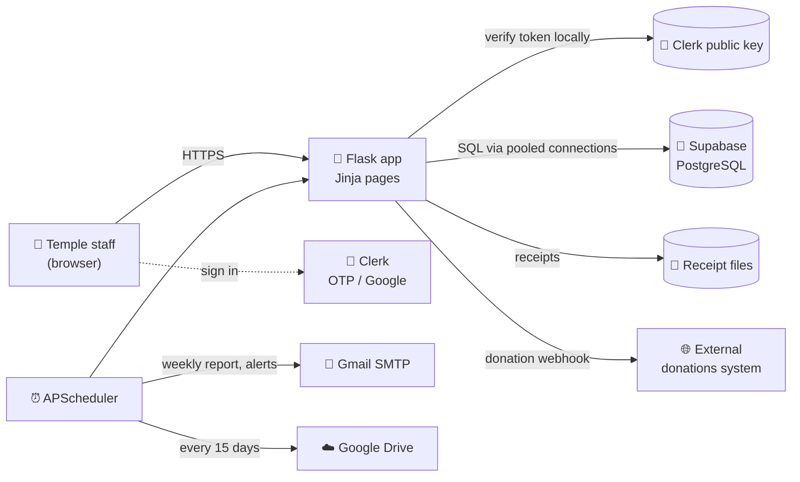
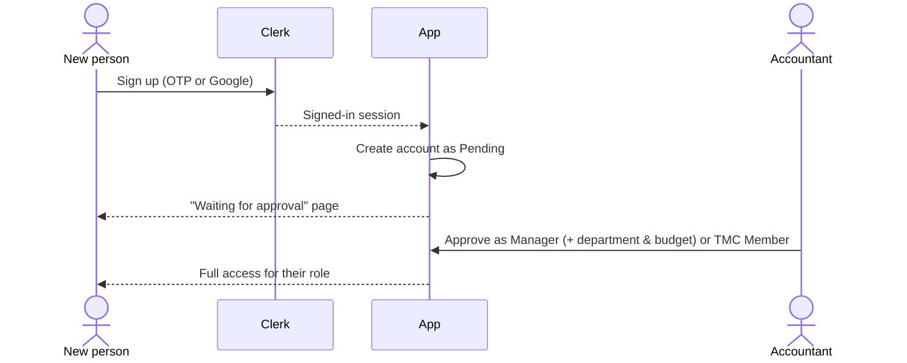
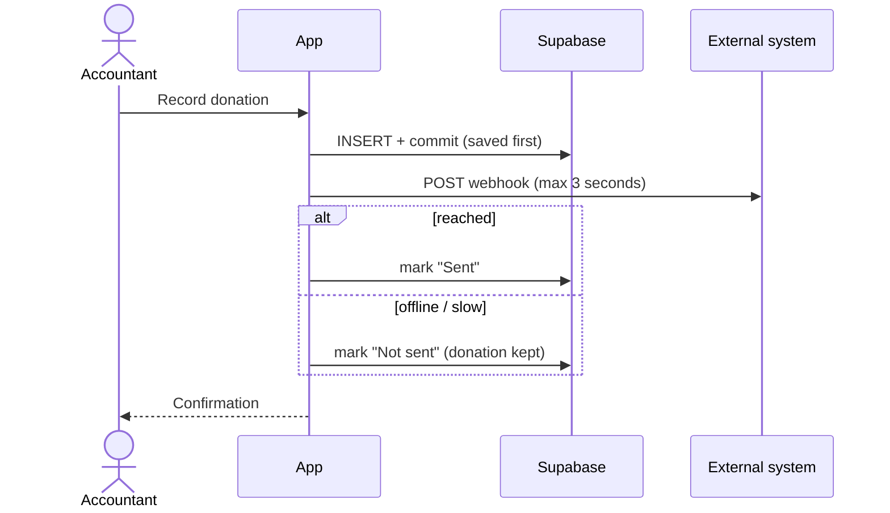

<div align="center">


# 🪷 ISKCON Shirpur — Mindful Finance

### Transparent, department-wise expense, budget and donation management for the temple

*हरे कृष्ण — every rupee accounted for, every seva supported.*

<br>


[✨ Features](#-features) •
[👥 Roles](#-who-can-do-what) •
[🏗️ Architecture](#%EF%B8%8F-architecture) •
[🚀 Quick start](#-quick-start) •
[⚙️ Configuration](#%EF%B8%8F-configuration) •
[🤝 Team](#-team)

</div>

---

## 🌸 Why this exists

A temple runs on many departments at once — **Construction, Prasadam, Festivals, Seva, Administration** — each spending from its own budget, while donations come in every day. Keeping all of that in notebooks and spreadsheets makes it hard to answer simple questions: *How much has Prasadam spent this month? Who approved this bill? Which donations reached the trust?*

**Mindful Finance** puts it all in one place: every expense tied to a department and a receipt, every budget watched automatically, every donation recorded and reported, and every action written to an audit log the temple committee can review at any time.

---

## ✨ Features

<table>
<tr>
<td width="50%" valign="top">

### 💰 Expenses & budgets
- Log expenses per department with **bill / voucher receipts** (images or PDF)
- Monthly **budget per department** with live *spent vs. remaining*
- Managers are **blocked from overspending** their budget
- Dashboard charts of spend against budget across departments

</td>
<td width="50%" valign="top">

### 🙏 Donations
- Record donor name, amount, method (**Cash / UPI / Bank**), transaction ID, notes and **date of birth**
- Each donation is **sent to the external donations system** (webhook, 3-second timeout — the donation is always saved first)
- **Download CSV / PDF** of all donations
- **“Send Report to Temple”** emails both files in one click

</td>
</tr>
<tr>
<td width="50%" valign="top">

### 🔔 Alerts & queries
- Raise **alerts** on a department or **queries** on a specific expense
- Queries go **to the person you choose** — not blindly to the department manager
- Automatic **end-of-month report** alert for every department
- Unresolved count badge in the navigation bar

</td>
<td width="50%" valign="top">

### 📊 Reports & audit
- Filter by department and date range, export **PDF statements** (with the temple logo) or **CSV**
- Full **audit log** of every change — who did what, and when
- Read-only access for the temple committee (TMC Members)

</td>
</tr>
<tr>
<td width="50%" valign="top">

### 🔐 Sign-in & access
- **Passwordless sign-in** with Clerk — email/phone OTP or Google
- New sign-ups wait as **Pending** until the Accountant approves them
- Approving a Manager **assigns their department and monthly budget** in the same step
- Session tokens verified **locally** — no waiting on a third party on every page

</td>
<td width="50%" valign="top">

### 🤖 Runs itself
- 📧 Donations CSV + PDF emailed to the temple **every 7 days**
- 💓 **Daily keep-alive** so the free Supabase project never pauses
- 🚨 **Urgent email** to the Accountant if the database goes offline
- 🩺 Weekly database **health-check** email
- ☁️ Receipts **backed up to Google Drive** every 15 days

</td>
</tr>
</table>

---

## 👥 Who can do what

| | 🧮 **Accountant** | 🏛️ **TMC Member** | 🧑‍💼 **Manager** | ⏳ **Pending** |
|---|:---:|:---:|:---:|:---:|
| View dashboard | ✅ all departments | ✅ all departments | ✅ own department | — |
| Add / edit expenses | ✅ | 👁️ view only | ✅ own department, within budget | — |
| Set budgets, edit departments | ✅ | 👁️ | — | — |
| Record donations | ✅ | 👁️ view + download | — | — |
| Email donations report | ✅ | — | — | — |
| Raise alerts & queries | ✅ | ✅ | receives them | — |
| Reports (PDF / CSV) | ✅ | ✅ | ✅ own department | — |
| Audit log | ✅ | ✅ | — | — |
| Approve sign-ups, manage users | ✅ | — | — | — |

> A **Pending** account sees only a “waiting for approval” page until an Accountant approves it as a Manager or TMC Member.

---

## 🏗️ Architecture



<details>
<summary><b>🔄 How a new person gets access</b></summary>



</details>

<details>
<summary><b>🙏 What happens when a donation is recorded</b></summary>



</details>

### 📁 Project layout

```
expense-tracker/
├── app.py                      # Routes, role checks, request hooks
├── config.py                   # All settings, read from .env
├── database/
│   └── db.py                   # Postgres pool + SQLite for tests, migrations
├── services/
│   ├── clerk_auth.py           # Clerk sign-in, local token verification
│   ├── donation_report_service.py  # Donations CSV / PDF / email report
│   ├── report_service.py       # Expense statements (PDF / CSV)
│   ├── scheduler_service.py    # Background jobs
│   ├── email_service.py        # SMTP email
│   ├── backup_service.py       # Google Drive backup
│   └── whatsapp_service.py     # Optional WhatsApp notifications
├── templates/                  # Jinja pages
├── static/                     # CSS, JS, fonts, logo, backgrounds
├── tests/test_app.py           # Automated tests (pytest)
├── supabase_schema.sql         # Database schema for a new Supabase project
├── requirements.txt
└── Procfile                    # Production start command (gunicorn)
```

---

## 🚀 Quick start

**You need:** Python 3.13, a free [Supabase](https://supabase.com) project and a free [Clerk](https://clerk.com) application.

```bash
# 1. Get the code
git clone https://github.com/Sanidhyacodes-03/mindful-finance-iskcon.git
cd mindful-finance-iskcon

# 2. Create a virtual environment and install packages
python -m venv .venv
.venv\Scripts\activate          # Windows
# source .venv/bin/activate     # macOS / Linux
pip install -r requirements.txt

# 3. Create your settings file and fill it in (see Configuration below)
copy .env.example .env          # Windows
# cp .env.example .env          # macOS / Linux

# 4. Run
python app.py
```

Open **http://localhost:5001** and sign in. 🎉

> **First run on a new Supabase project:** paste `supabase_schema.sql` into the Supabase **SQL Editor** and run it once. Columns added later are created automatically when the app starts.

### 🧪 Run the tests

```bash
pytest tests/test_app.py -q
```

Tests run against a throw-away local SQLite database — they never touch Supabase, never call Clerk and never send real email.

---

## ⚙️ Configuration

All settings live in `.env` (never committed). `.env.example` lists every option with comments.

| Setting | Required | What it's for |
|---|:---:|---|
| `SECRET_KEY` | ✅ | Protects login cookies — any long random string |
| `DATABASE_URL` | ✅ | Supabase → Project Settings → Database → Connection string (port 5432) |
| `CLERK_SECRET_KEY` | ✅ | Clerk dashboard → API Keys |
| `CLERK_PUBLISHABLE_KEY` | ✅ | Clerk dashboard → API Keys |
| `CLERK_JWT_KEY` | ⭐ recommended | Clerk → API Keys → JWT public key — makes sign-in checks fully offline |
| `SMTP_SERVER`, `SMTP_PORT`, `SMTP_USERNAME`, `SMTP_PASSWORD`, `SENDER_EMAIL` | ✅ for email | e.g. Gmail with an App Password |
| `START_SCHEDULER` | ✅ for automation | `true` turns on the weekly report, keep-alive, alerts and backups |
| `DONATIONS_REPORT_EMAIL` | optional | Who receives the donations report (default `shirpuriskcon@gmail.com`) |
| `ADMIN_ALERT_EMAIL` | optional | Who receives database alerts |
| `DONATIONS_WEBHOOK_URL` | optional | External donations system endpoint |
| `GOOGLE_SERVICE_ACCOUNT_FILE`, `GOOGLE_DRIVE_BACKUP_FOLDER_ID` | optional | Google Drive receipts backup |

Generate a `SECRET_KEY`:

```bash
python -c "import secrets; print(secrets.token_hex(32))"
```

> 🔒 **Never put real passwords or keys in `.env.example`** — this repository is public. Real values go only in `.env` and in your hosting provider's environment settings.

---

## 🌐 Production

The app runs on its own **custom domain over HTTPS**.

1. **Install:** `pip install -r requirements.txt`
2. **Start:** `gunicorn app:app --workers 1 --threads 4 --timeout 60` (also in the `Procfile`)
3. **Settings:** add every value from the table above to the server's environment, including `START_SCHEDULER=true`.
4. **Sign-in:** use a Clerk **production** instance for the domain (`pk_live_` / `sk_live_` keys) with its DNS records verified.

> Keep **one worker** so background jobs run exactly once, and keep the server always on so the weekly report and keep-alive jobs never miss a run.

---

## 🛠️ Built with

| Layer | Technology |
|---|---|
| Backend | Python 3.13 · Flask 3.1 · Jinja2 |
| Database | Supabase PostgreSQL (psycopg2 connection pool) · SQLite for tests |
| Sign-in | Clerk (OTP, Google) · PyJWT local verification |
| Documents | ReportLab (PDF) · Python `csv` |
| Automation | APScheduler · smtplib · Google Drive API |
| Hosting | gunicorn · custom domain with HTTPS |
| Testing | pytest (40 tests) |

---

## 🤝 Team

<table>
<tr>
<td align="center" width="200">
<a href="https://github.com/Sanidhyacodes-03"><br><b>Sanidhya Singh Sisodiya</b></a><br><sub>@Sanidhyacodes-03</sub>
</td>
<td align="center" width="200">
<a href="https://github.com/abhinavgupta30"><br><b>Abhinav Gupta</b></a><br><sub>@abhinavgupta30</sub>
</td>
<td align="center" width="200">
<a href="https://github.com/sameerpatwa1425-droid"><br><b>Sameer Patwa</b></a><br><sub>@sameerpatwa1425-droid</sub>
</td>
</tr>
</table>

---

<div align="center">

### 🙏 Made with devotion for ISKCON Shirpur

*Every act, every offering, done as service to Kṛṣṇa* — inspired by Bhagavad Gītā 9.27

**Hare Kṛṣṇa Hare Kṛṣṇa · Kṛṣṇa Kṛṣṇa Hare Hare · Hare Rāma Hare Rāma · Rāma Rāma Hare Hare**

<sub>If this project helps your temple, please give it a ⭐</sub>

</div>
